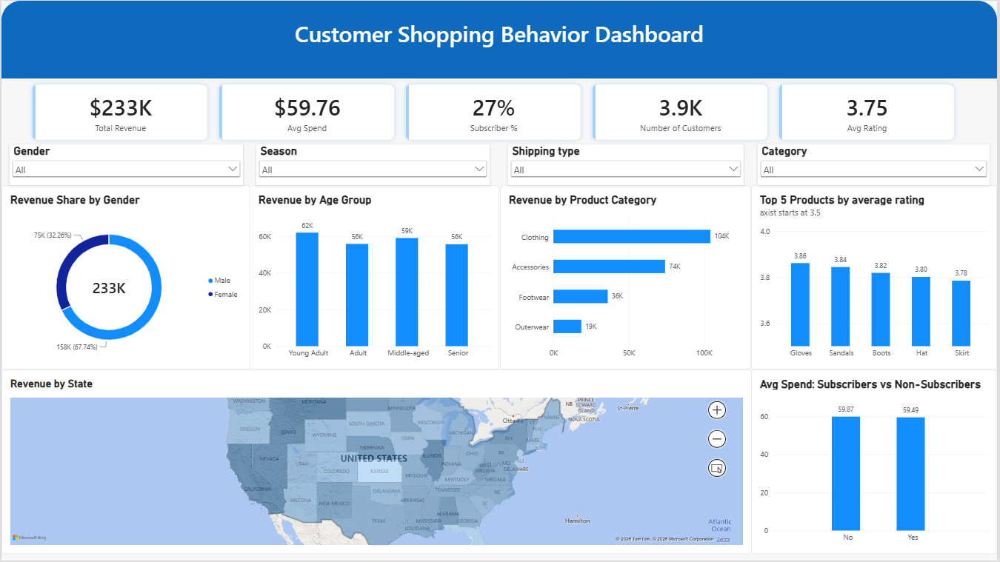

# Customer Shopping Behavior Analysis

End-to-end analysis of customer shopping behavior: data cleaning in Python, business questions answered with SQL, and an interactive Power BI dashboard.



## Project goal

Understand who the customers are and what drives revenue: which segments (gender, age group, location), product categories and seasons contribute most, and whether subscriptions or discounts change spending.

## Dataset

- Raw and Processed dataset attatched in the data folder
- **Size:** 3,900 rows, 18 columns (19 after feature engineering, 19 after dropping a duplicate column)
- **Key columns:** `customer_id`, `age`, `gender`, `item_purchased`, `category`, `purchase_amount`, `location`, `season`, `review_rating`, `subscription_status`, `shipping_type`, `discount_applied`, `previous_purchases`, `payment_method`, `frequency_of_purchases`

## Tools

Python (pandas) · PostgreSQL / SQL · Power BI · Git and GitHub

## Data cleaning (`notebooks/01_data_cleaning.ipynb`)

1. Checked structure, data types and missing values with `info()`, `describe()` and `isnull()`.
2. Found 37 missing `review_rating` values and filled each with the **median rating of its product category**.
3. Standardized column names to lowercase snake_case (`Purchase Amount (USD)` became `purchase_amount`).
4. Created `age_group` (Young Adult, Adult, Middle-aged, Senior) using age quartiles.
5. Created `purchase_frequency_days` by mapping text frequencies (Weekly, Monthly, Quarterly, etc.) to a number of days.
6. Verified that `promo_code_used` was identical to `discount_applied` on every row, then dropped it as redundant.
7. Saved the cleaned data to `data/processed/customer_shopping_behavior_cleaned.csv`.

## SQL analysis (`sql/` and `notebooks/02_sql_analysis.ipynb`)

The cleaned data was loaded into a `shopping_behavior` table and queried to answer business questions:

- Overall KPIs: customers, total revenue, average spend, average rating
- Revenue by gender
- Revenue by category and by season
- Revenue by age group
- Top 5 products by average review rating
- Subscribers vs non-subscribers: customers, average spend, revenue
- Discount vs no discount: average spend
- Top states by revenue

The notebook `02_sql_analysis.ipynb` runs the same queries against SQLite so the results render directly on GitHub.

## Dashboard (`dashboard/customer_shopping_dashboard.pbix`)

A one-page Power BI dashboard connected to the PostgreSQL table, with:

- KPI cards: total revenue, average spend, subscriber %, number of customers, average rating
- Revenue share by gender, revenue by age group, revenue by product category
- Top 5 products by average rating
- Revenue by state (filled map)
- Average spend: subscribers vs non-subscribers
- Slicers for gender, season, shipping type and category

## Key findings


- **Total revenue is about $233K** across 3,900 customers, with an average spend of about $59.76 per purchase.
- **Male customers generate about 68% of revenue** ($158K) versus about 32% ($75K) from female customers.
- **Clothing is the top category** (about $104K), followed by Accessories ($74K), Footwear ($36K) and Outerwear ($19K).
- **Revenue is spread evenly across age groups** (about $56K to $62K each), with Young Adults slightly ahead.
- **Subscribers do not spend more per order**: about $59.49 for subscribers versus $59.87 for non-subscribers. About 27% of customers are subscribers.
- **Top-rated products** are Gloves (3.86), Sandals (3.84), Boots (3.82), Hat (3.80) and Skirt (3.78), a narrow range.

## Recommendations

- Since subscribers spend the same per order, evaluate the subscription on retention and purchase frequency rather than order value.
- Female customers are a smaller share of revenue, which may be an opportunity for targeted campaigns.
- Outerwear and Footwear lag behind Clothing and Accessories, so review pricing, range and promotions there.

## Repository structure

```
customer-shopping-behavior-analysis/
├── README.md
├── .gitignore
├── requirements.txt
├── data/
│   ├── raw/
│   │   └── customer_shopping_behavior.csv
│   └── processed/
│       └── customer_shopping_behavior_cleaned.csv
├── notebooks/
│   ├── 01_data_cleaning.ipynb
│   └── 02_sql_analysis.ipynb
├── sql/
│   ├── 01_create_table.sql
│   └── 02_business_queries.sql
└── dashboard/
│   ├── customer_shopping_dashboard.pbix
│   └── dashboard_preview.png
├── report/
│   ├── customer_shopping_behavior_cleaned.pdf
│   ├── customer_shopping_behavior_cleaned.pptx
```

## How to run

1. Clone the repo and install the requirements:
   ```bash
   git clone https://github.com/Zungazzz/customer_behaviour_analysis
   cd customer-behavior-analysis
   pip install -r requirements.txt
   ```
2. Run `notebooks/01_data_cleaning.ipynb` to reproduce the cleaned dataset.
3. Run `notebooks/02_sql_analysis.ipynb` to see the SQL results (uses SQLite, no setup needed).
4. To use PostgreSQL instead, run `sql/01_create_table.sql`, import the cleaned CSV into the table, then run `sql/02_business_queries.sql`.
5. Open `dashboard/customer_shopping_dashboard.pbix` in Power BI Desktop (Windows). It was built on a local PostgreSQL table, so to refresh the data, point it at your own copy or at the cleaned CSV.

## Author

Nishan Jung Suwal · [GitHub](https://github.com/Zungazzz/)
